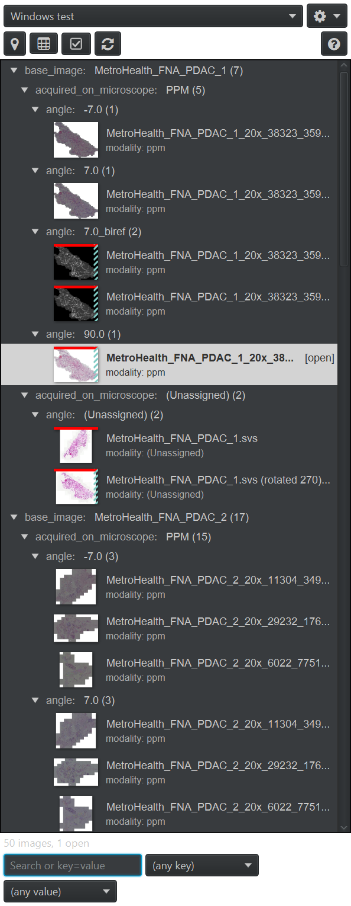

# Project+ -- User Guide

Project+ is a second Project tab for QuPath that groups a project's images by the metadata
keys you choose, marks the image open in the viewer, shows which images carry saved
annotations, detections or TMA cores, and lets you act on many images at once. What it is
for, and whether you need it, is in the [README](../README.md#do-you-need-this); this guide
is the tab control by control.

Throughout this guide:

| Word | What it means |
|---|---|
| **entry** | one image in the project; one row in the tree |
| **group** | a tree node that holds every entry sharing one value of a grouping key |
| **grouping key** | a metadata key or built-in field the tree is nested by |
| **display profile** | a named, saved set of grouping keys and display settings |
| **current image** | the image shown in the viewer |
| **saved data** | the objects QuPath stored for an entry the last time it was saved |
| **checkbox mode** | the mode in which every row gets a checkbox |
| **checked images** | the entries whose box is checked; what the **Actions** menu acts on |

*Check* and *checked* mean the checkbox-mode boxes on the rows; *tick* and *ticked* mean a
checkbox in a dialog or in Preferences.

The full [glossary](#glossary) at the end of this page has every term, including the four
destructive verbs, which are deliberately different words for different things.

Most of this guide is in collapsible sections. Your browser's find-in-page does not search
inside a collapsed one, so if you are looking for a message you saw on screen, open
[Troubleshooting](#troubleshooting) first, or expand all sections.

---

<details open>
<summary><strong>The tab at a glance</strong> (read this first)</summary>

### The tab at a glance

If you have not yet grouped a project and saved a profile, do the
[README quick start](../README.md#quick-start) first; it takes six steps. This section is
the inventory of what is on the tab.

**Prerequisites.** QuPath 0.7.0 or later, the extension installed, QuPath restarted, and a
project open. Without a project the tab shows a placeholder, `No project is open.`, with
**Create project...** and **Open project...** buttons under it. A project with no images
shows `No images in this project. Use Add images... in the gear menu or File > Project.`

**Where the tab is.** In the analysis pane on the left of the QuPath window, immediately
right of the built-in **Project** tab. Right-click the tab and choose **Undock tab** to move
it into its own window; everything in it works the same way undocked. By default Project+
selects its own tab when QuPath starts with a project open (see
[Settings and preferences](#settings-and-preferences) to turn that off).

**The toolbar.** Two rows at the top of the tab:

- Row 1: the **profile combo** (the dropdown that says which display profile is in use; a
  trailing ` *` means you have changed something since it was saved) and the **gear** menu
  button.
- Row 2: **Jump to current image** (a pin), **Group by** (a grid), **Checkbox mode**,
  **Refresh** (two arrows), and, at the right, the **Legend** button (a question mark) that
  explains the indicators and the search keywords. The buttons are icons; hover one for its
  name.

![The Project+ tab on Windows, light theme, profile Default with a trailing asterisk, grouped three levels deep. Group rows read base_image: MetroHealth_FNA_PDAC_1 (7), acquired_on_microscope: PPM (5), angle: -7.0 (1), and so on; each image row shows a thumbnail, the image name and a modality: ppm line; some thumbnails carry a red top edge and a hatched teal right edge; one row is tinted, bold and marked [open]; the status line reads 52 images, 1 open.](../images/tab-grouped.png)

*The tab grouped by `base_image`, then `acquired_on_microscope`, then `angle`, with the
`modality` key shown as a field under each name. Each group row names its key and value and
the number of images under it. The red top edge and hatched teal right edge on a thumbnail
show that its saved data holds annotations and detections. The open image's row is tinted,
bold and marked `[open]`; the ` *` after `Default` means the grouping has not been saved to
the profile.*

The gear menu holds, in order:

- **Save profile**, **Save profile as...**, **Rename profile...**, **Delete profile...**,
  **Manage profiles...**
- **Edit display settings...**, **Thumbnail size** (Hidden / Small / Medium / Large),
  **Indicators** (Thumbnail edges / Badges / Off)
- **Create project...**, **Open project...**, **Add images...**
- **Remove current image...**, **Jump to current image (Ctrl+J)** (`Jump to current image
  (Cmd+J)` on macOS)
- **Show built-in Project tab** (a check item), **Indicator legend...**, **Set current image
  highlight color...**

![The gear menu open over the tab on Windows. Items in order: Save profile (grayed), Save profile as..., Rename profile... (grayed), Delete profile... (grayed), Manage profiles...; Edit display settings..., Thumbnail size, Indicators; Create project..., Open project..., Add images...; Remove current image... (grayed), Jump to current image (Ctrl+J) (grayed); Show built-in Project tab (checked), Indicator legend..., Set current image highlight color.... Behind it, collapsed group rows show chips such as A D - and - - -.](../images/profile-menu.png)

*The gear menu with no image open (the two current-image items are grayed) and **Default**
in use (**Rename profile...** and **Delete profile...** are grayed, because Default cannot be
renamed or deleted).*

**First look.** On first open the tree is grouped by the key the built-in tab was sorting by,
if one was set for this project; otherwise it is a flat list, like the built-in tab. Group
rows read as the key, the value and the number of images under them, so a patient with three
stains and eight images reads `Patient: 12 (8)`, and the stain groups under it read
`Stain: HE (3)`. The number in parentheses counts images, not objects, at any depth below the
group, and only the ones that pass the current search. Missing values land under
**(Unassigned)**; an entry whose file location cannot be read lands under **Undefined**.
Thumbnails and indicators fill in after the tree appears; they are read in the background,
and a busy strip under the toolbar reads `Loading saved-data summaries 120 of 412` while that
takes longer than a moment.

**What each row shows.** A thumbnail (size set by the profile), the image name (masked names
are honored exactly as in the built-in tab), optionally a second line of `key: value` pairs
chosen in the display settings, and the saved-data indicators drawn on the thumbnail's edges.
An entry with no saved data has its name in *italic*, the same convention QuPath's own tab
uses. The current image's row is tinted, its name is bold, and an `[open]` chip sits at the
right end of the row; when that row is hidden inside a collapsed group, the group rows above
it carry the tint and an `[open inside]` chip instead. Hover a row for the full details: its
first line says `Open in viewer`, `Open in viewer, unsaved changes`, `No saved data`,
`Saved data: no objects` or the counts (`Saved data: 12 annotations, 4,310 cells, 96 TMA
cores`), followed by QuPath's usual summary and a larger thumbnail.

**Opening an image.** Double-click an entry, or select it and press Enter. The row for the
image you opened becomes the current-image row, and if it passes the current search the tree
expands the groups above it, selects it and scrolls to it.

**The status line**, just above the search box, reads `412 images`, `412 images, 1 open`,
`38 of 412 images shown` while a search is in force, or `412 images, 3 checked` in checkbox
mode. Messages about an action you just took (`Jumped to liver_12_HE_0.svs`,
`Refreshed: 412 images`) show there for four seconds. A warning (for example a profile that
groups by a key this project lacks) stays for eight seconds and may wrap onto a second line
in a narrow pane; the totals always fit on one. Click the status line to clear the search
and the key/value filter.

**The built-in Project tab is untouched.** Everything it does keeps working whether it is
shown or hidden; see [Hide the built-in Project tab](#hide-the-built-in-project-tab).



*The same tab in QuPath's dark theme. The current-image tint, the muted field text and the
indicator colors follow the theme.*

</details>

<details>
<summary><strong>Common tasks</strong></summary>

### Group by several metadata keys

1. Click **Group by** in the toolbar (or gear > **Edit display settings...**, or right-click
   a row and choose **Group by...**). The **Project+ - Display settings (<profile>)** dialog
   opens with its **Grouping** section expanded; the title names the profile in use, with
   ` *` while it has unsaved changes. It is not modal: leave it open and watch the tree
   regroup as you change it.
2. Click **Add level** and pick a key. The menu lists the built-in fields first
   (**Image name**, **File name**, **Entry ID**, **Image type**), then every metadata key used
   anywhere in the project, alphabetically. Keys already in use are disabled. A project with
   no metadata shows a grayed line `This project has no metadata keys yet.` in place of the
   key list.
3. Add a second level the same way. The list reads outermost level first; **Up** and **Down**
   move the selected level outward or inward, **Remove** drops it. The tree rebuilds as
   *first key > second key > ... > entries*. With no levels the tree is flat.
4. Read the line under the list, `Groups: 12 > 31 > 96 images in 31 leaves`, before you look
   at the tree: level 1 made 12 groups, level 2 made 31, and the 96 images sit in those 31
   innermost groups. It tells you whether you just made 400 groups of one image.
5. Choose **Expand on load**: all, first level, or none. This also applies whenever the
   grouping changes. With *first level* and two or more levels, every image sits under a
   closed inner group right after the tree builds; expand a group to reach its images, or
   choose *all* while you learn the tree. *none* suits a project of several hundred images
   grouped by patient: the tree opens as a short list of patients, and **Jump to current
   image** or a search opens only the branch you need.
6. Click **Save to profile** to keep the setup in the selected profile, or **Close** to keep
   the live state without saving it (the profile combo shows ` *` until you save).


*The display settings dialog: two grouping levels, the group count line, two fields ticked,
and the thumbnail size options. This capture is from an earlier build: **Down** is now
disabled until a level is selected, and the title now names the profile. The Indicators row
under Appearance is below the visible area.*

Notes:

- Entries missing a value for any level land under **(Unassigned)** at that level, so nothing
  disappears when you add a key.
- When **Mask image names** is on (QuPath's own setting, in the row's right-click menu),
  **Image name** and **File name** are not offered as levels, because grouping by them would
  reveal the names.
- **Image type** comes from the summary QuPath writes when an image is saved; an entry that
  has never been saved groups under **(Unassigned)** for that level.
- **Entry ID** makes one group per image, labeled with its ID. Use it to match a
  `<entry ID>.geojson` file from a masked export, a `data/<id>` folder, or an ID from a log
  line back to its image, or to find an image while names are masked.
- The dialog closes itself when you switch projects, because its key list would be stale.

### Show metadata under each name

1. Open the display settings (**Group by** or gear > **Edit display settings...**).
2. Expand **Fields shown under the name** and tick the keys to show. The four built-in fields
   are listed first with a `(built-in)` suffix (**Image name**, **File name**, **Entry ID**,
   **Image type**); the two name fields are withheld while **Mask image names** is on.
3. The second line of each row shows `Stain: HE | Angle: 0`, with `key: (Unassigned)` for a
   missing value. Rows grow a little taller to make room.

Show a key as a field when it varies within a group but is not worth a level: grouped by
Patient > Stain, a `Scanner` or `Angle` line under each name tells the two scans of one slide
apart without doubling the tree depth.

### Change the thumbnail size or the indicator style

Gear > **Thumbnail size** > Hidden / Small / Medium / Large, and gear > **Indicators** >
Thumbnail edges / Badges / Off. The same options are under **Appearance** in the display
settings dialog. Both are part of the profile, so **Save profile** keeps them.

The four sizes are the slot the thumbnail is fitted into, in screen pixels: **Hidden**
20 x 20 (an empty square that still carries the indicator edges), **Small** 50 x 40,
**Medium** 100 x 80, **Large** 150 x 120, the same four sizes as the built-in tab's
*Project thumbnail size* preference.

### Jump to the current image

1. Open any image (double-click an entry, use the built-in tab, or **File > Open...**).
2. Click **Jump to current image** in the toolbar, press Ctrl+J with focus in the tab, or
   choose **Jump to current image (Ctrl+J)** from the gear menu or **Jump to current image**
   from the right-click menu. The shortcut shown in the gear item's text is a reminder, not a
   global shortcut: Ctrl+J acts only with focus in the tab.
3. The tree expands every group above the entry, selects it and scrolls it into view. The
   status line reads `Jumped to <name>`.

Notes:

- The button is disabled when no image is open or when the open image is not an entry of
  this project, for example a file opened with **File > Open...**. Hover the disabled button
  and a tooltip says which: `No image is open.` or
  `The current image is not in this project.`
- If a search or key/value filter currently hides the entry, Jump **clears the search text and
  both filter combos**, rebuilds the tree and then jumps. The status line says so, in the
  warning color: `Search cleared to show <name>`. The automatic reselect that happens whenever
  you open an image never clears a search: if the row passes the current search it expands
  the groups above it and scrolls to it, otherwise it does nothing.

### Save and switch display profiles

A profile is the whole display state of the tab: grouping levels, expand-on-load, fields
shown, thumbnail size and indicator style. **Default** always exists and cannot be renamed or
deleted.

Keep one profile per way you read the project: `By patient` (Patient > Stain, field Scanner)
for annotation sessions, `Review queue` (Stain > Image type, Badges on, thumbnails Hidden)
for checking which images still have no saved data, and `Flat` (no levels, Large thumbnails)
for picking an image by eye. Switching takes one click in the combo.

1. Set up the tab the way you want it.
2. Gear > **Save profile as...** opens **Project+ - Save profile as**; type a name such as
   `By patient` and confirm. **OK** stays disabled while the field is empty or reads
   `Default`, which is the reserved name of the built-in profile. If the name exists,
   **Project+ - Profile name exists** asks `A profile named "<name>" already exists. Replace
   it?` with **Replace** and **Cancel**. The status line confirms `Saved profile "<name>"`.
3. Later changes mark the combo ` *`. Gear > **Save profile** (or **Save to profile** in the
   display settings) writes them back to the selected profile.
4. Switch profiles from the combo. If the current one has unsaved changes,
   **Project+ - Unsaved profile changes** asks `Save your changes to profile "<name>" before
   switching?` with **Save**, **Discard** and **Cancel**.
5. Gear > **Rename profile...** and **Delete profile...** act on the selected profile; delete
   asks `Delete profile "<name>"? This cannot be undone.` in **Project+ - Delete profile**.
6. Gear > **Manage profiles...** opens **Project+ - Manage profiles**: the list in combo
   order, with **Duplicate**, **Rename...**, **Delete...**, **Reset Default** (enabled only
   on Default; restores its original settings) and **Move up** / **Move down** to reorder the
   combo. The dialog shows the path of the profiles file as selectable text.

Notes:

- A profile name is trimmed of leading and trailing spaces, must not be empty and must not
  be exactly `Default`. Names are case-sensitive: `By patient` and `by patient` are two
  profiles, and **Save profile as...** only offers to replace a profile whose name matches
  exactly. Any other characters and any length are accepted.
- Profiles are yours, not the project's: they live in one file in your QuPath user directory
  (see [Profiles file](#profiles-file-location-and-format)) and apply to every project you
  open. A profile that names a key this project does not use still works: that level groups
  everything under **(Unassigned)** and the status line warns
  `Profile "<name>" groups by "Scanner", which this project does not have`.
- The last profile you used is remembered in two places: for you, in QuPath's preferences,
  and for the project, in its metadata (the profile name as you typed it, under the key
  `_PROJECT_TAB_PLUS_PROFILE`), so a shared project reopens the way it was left. When a
  project opens, its own remembered profile wins; otherwise your last-used one; otherwise
  **Default**.
- Only the profile's *name* travels with a shared project. Its body (the grouping and
  settings) is in your own profiles file, so a colleague who opens the project on a machine
  without that profile gets **Default** and the status line warns, in the warning color,
  `Profile "<name>" is not on this machine; showing Default`. Copy the profiles file to the
  other machine, or save the profile there under the same name. Storing the profile body in
  the project is planned for a later release.
- Unsaved profile changes are dropped silently when you quit QuPath. Quitting is never delayed
  by a profile prompt.

### Read the current-image highlight

The current image's row has a tinted background, a bold name and an `[open]` chip at the
right end of the row. When you close the image or open another, the mark moves. If the row
is hidden because a group above it is collapsed, every group row on the path down to the
collapsed one is tinted and bold and ends with an `[open inside]` chip, so a glance at the
top level still tells you where the image is; expand the chain (or press **Jump to current
image**) and the mark returns to the image row alone. When a marked row is also selected,
the selection color covers the tint and the bold name plus the chip carry the state. The tint
is the theme's color by default.

![The Project+ tab with the open image's group collapsed. The rows base_image: MetroHealth_FNA_PDAC_1 (7), acquired_on_microscope: PPM (5) and angle: 90.0 (1) are tinted, bold and end with an [open inside] chip; the collapsed angle row also shows the chips A D -.](../images/ancestor-highlight.png)

*The open image sits inside the collapsed `angle: 90.0` group, so that row and the two
above it are tinted, bold and marked `[open inside]`. The collapsed row's `A D -` says an
image under it has annotations and detections but no TMA cores.*

To use your own color:

1. **Right-click any row** (or open the gear menu) **and choose Set current image highlight
   color...**. The **Project+ - Current image highlight color** window opens.
2. **Untick Use the theme color (default).** The **Color** picker becomes active.
3. **Pick a color.** The marked rows behind the window change as you pick; **Close** is the
   only button.

The same two settings are **Custom current image highlight** and **Current image highlight
color** in **Edit > Preferences > Project+**. If no row is marked while an image is open, the
image is not an entry of this project. If Active Image Helper is installed it marks the same
image on the built-in tab in its own way; the two do not interact.

### Read the saved-data indicators

With the default **Thumbnail edges** style, each thumbnail can carry up to three colored
edges drawn inside the thumbnail:

- **top edge** (solid line, 3 px) = annotations present,
- **right edge** (diagonal hatching `////`, 5 px) = detections, cells or tiles present,
- **bottom edge** (solid line, 3 px) = TMA cores present.

The counts come from the object counts QuPath writes into its summary at save time, one per
object class: *Annotations*, *Detections*, *Cells*, *Tiles*, *TMA cores*. The top edge is the
Annotations count; the right edge is Detections + Cells + Tiles (QuPath counts the three
separately and the row tooltip shows them separately); the bottom edge is the number of TMA
core objects, so an empty TMA grid shows nothing. Objects of other classes are not counted.
For the open image, *unsaved changes* means QuPath's own changed flag, the one that makes it
ask whether to save on close; the edges update about half a second after the last edit and
up to two seconds after a save.

The left edge is never used. Annotation and TMA edges use the colors QuPath draws those
objects in; the detections edge is a fixed teal, because QuPath has no distinct default color
for detections. Position is the primary cue; color only reinforces it. The detections edge is
hatched rather than solid so that it differs from the annotation edge by shape, not only by
color: with QuPath's default red for annotations, a solid red line and a solid teal line sit
too close for red-green color vision.

With the **Badges** style, a second line under the name shows letter chips with counts:
`A 12   D 4.3k   T 96`, with `--` for an absent type and an asterisk after a count that comes
from unsaved changes. Counts are shortened on the badge: exact below 1,000; one decimal with
`k` up to 9,999 (rounded, so 1,250 shows `1.3k`); whole thousands from 10,000 (cut down, so
43,999 shows `43k`); one decimal with `M` from a million. Hover the row for the exact numbers.
A collapsed group row shows `A D T` after its count, with `-` in place of any type no image
under it has (`A - T`), in either indicator style; an expanded group shows nothing.

Choose **Badges** when you want counts without hovering (a batch where every image should
have about 4,000 cells, and `D 1.2k` on one row is the outlier), when thumbnails are
**Hidden** to fit more rows on a laptop screen, or when color on a thumbnail is hard to read.
Choose **Thumbnail edges** to keep the rows short.

Click the **Legend** button (or gear > **Indicator legend...**) for the
**Project+ - Indicator legend** window, which reads:

```
Thumbnail edges and badges show what each image's SAVED data holds.
  Top edge / A   = annotations
  Right edge (hatched) / D = detections, cells and tiles
  Bottom edge / T = TMA cores
Solid edge or close hatching = from the last save. Dashed edge, widely
spaced hatching or * = the image is open and has unsaved changes, so the
counts come from the viewer.
No edges: no saved data (italic name), no objects, or not loaded yet.
Hover a row to see the exact counts.
Search tip: has=annotations, has=detections, has=tma, has_data=false.
```

Notes:

- The indicators describe **saved** data: what was on disk the last time that image was saved.
  The current image is the exception: its edges follow the live objects in the viewer and turn
  **dashed** (the hatched detections edge spreads its marks twice as far apart) as soon as
  there are unsaved changes, then solid again when you save.
- Three states look alike at a glance (no edges) and the row tooltip tells them apart:
  `No saved data` (also italic name), `Saved data: no objects`, and `Object summary not loaded
  yet`. Project+ never opens an entry's data file to find out, because that can take seconds
  per image; it reads only the small summary QuPath writes at save time.
- QuPath has written that summary at every save since version 0.2.0, so only an entry that
  was never saved, or last saved by a QuPath older than 0.2.0, shows no edges until it is saved
  again.
- If the summary exists but cannot be read, the tooltip says
  `Saved-data summary could not be read; see log`.
- There is no way yet to save these counts as a table. A project-wide summary export (one
  row per image with its metadata and counts) is planned for a later release; until then
  the Project Metadata Browser extension exports the metadata, and the counts stay on
  screen.

### Search and filter

The search box is at the bottom of the tab, where the built-in tab keeps its filter; its
prompt reads `Search or key=value`. Press Ctrl+F (Cmd+F on macOS) with focus in the tab to go
to it; Escape clears it and returns focus to the tree. The key and value combos next to it
(on a second line in a narrow pane) narrow the list further, and all three conditions apply
together.

Syntax of the search box:

| You type | It matches |
|---|---|
| `liver` | every entry whose image name contains `liver` (case-insensitive) |
| `Stain=HE` | every entry with a metadata pair whose `key=value` text **contains** `Stain=HE`, so `Stain=HER2` and `Counterstain=HE` match too. For an exact match use the key and value combos. |
| `liver\|Stain=HE` | entries that match **every** term: `\|` separates conditions that must all hold. It does not mean "or". |
| `has_data=true` / `has_data=false` | QuPath's own keyword: entries with / without a data file. `has_data=true` is true for an image saved with no objects at all; use `has=` to ask about object types. |
| `has=annotations`, `has=detections` (also `has=cells`; covers detections, cells and tiles), `has=tma` | entries whose saved data holds that object type. Singular forms work (`has=annotation`, `has=cell`). `has=tiles` is not a keyword: it is searched as plain text and matches nothing. |

Plain text and `key=value` terms use the same rules as the search box of QuPath 0.7's own
Project tab; the `has=` keywords are Project+'s addition. `has=` reads the saved-data
summary, not the data file. An entry with no summary (never saved, or last saved by a QuPath
older than 0.2.0) or with an unreadable summary never matches any `has=` keyword even if its
data file holds the objects, while `has_data=true` still lists it. Save those images once to
give them a summary.

The **key** combo offers `(any key)` plus every metadata key in the project; the **value**
combo offers `(any value)` plus the distinct values of the chosen key, including
`(Unassigned)`, which matches images that lack the key. Groups with no matching image are
dropped from the tree; expansion is kept by group path. The status line reads
`38 of 412 images shown`.

Example: to review every HE slide of patient 12 that has no saved data yet, pick `Patient`
and `12` in the combos and type `Stain=HE|has_data=false` in the search box. The status line
reads `3 of 412 images shown`, the tree keeps only the groups holding those three, and in
checkbox mode **Check all shown** checks exactly them.

### Remove the current image, and optionally move its file to the trash

The built-in tab's **Remove image...** acts on the *selected* rows; this command acts on the
*current* image, whichever rows are selected.

1. With the image open in the viewer, choose **Remove current image...** from the gear menu
   or the right-click menu. The item is disabled when no image is open or the open image is
   not in this project.
2. **Project+ - Remove current image** asks `Remove "<name>" from the project?` and explains
   that the image will be closed first. It carries two checkboxes:
   - `Move this image's saved data (annotations, detections, TMA grid) to the trash`,
     **unticked by default**. Left unticked, the entry's `data/<id>` folder stays in the
     project's data directory on disk after the entry is gone.
   - `Also move the image FILE to the trash`, unticked by default, with the file's path and
     size under it on one line (a long path is shortened in the middle; hover it for the
     whole path). While **Mask image names** is on that line reads
     `In folder <folder>  (<size>)` instead, so the dialog does not print the name it is
     hiding. When the file is not
     eligible the box is disabled and the line under it says why: `Cannot offer file
     deletion: this .vsi image has companion files that QuPath does not list.`, `Cannot offer
     file deletion: 3 other entries in this project use the same file.`, `Cannot offer file
     deletion: the file was not found.`, `Cannot offer file deletion: the image is not a
     local file.`, `Cannot offer file deletion: the image is spread over several files.` or
     `Cannot offer file deletion: the file is on a network location, which has no trash.`
3. Click **Remove**. **Cancel** is the default button, so Enter and Escape both leave the
   project as it is. If the image has unsaved changes, QuPath asks whether to save them,
   exactly as when you close an image; **Cancel** there cancels the whole removal (status
   `Removal canceled`). While the image closes, the busy strip under the toolbar reads
   `Closing and removing <name>`; closing a Bio-Formats image can take many seconds.
4. If you ticked the file box, a **second, separate** confirmation,
   **Project+ - Move image file to trash**, shows the path, size and modification date and
   asks `Move this file to the trash?`. **Keep file** is the default and is what Enter and
   Escape choose; **Move to trash** is the other button. The dialog reminds you that
   `QuPath cannot tell whether another project uses this file.` Size is shown in binary units
   (1 KB = 1024 bytes, one decimal; GB with two), so it can read a little smaller than a
   file manager that counts in thousands. The modification date is the file's last-modified
   time in this computer's local time, as `yyyy-MM-dd HH:mm`.
5. The entry leaves the project and both Project tabs refresh. The status line reads
   `Removed <name> from the project`, `Removed <name>; file moved to trash` or
   `Removed <name>; file kept at <path>`. If you ticked the saved-data box and the folder is
   still on disk afterwards (a desktop with no trash support), the status line reads
   `Removed <name>; data folder kept at <path>`. If the removal itself fails, a notification
   reads `The image could not be removed from the project; see the log (View > Show log).`
   and the entry stays.


*The remove dialog for a single-file image on a local disk: both boxes unticked, the file
line showing the path and size, and **Cancel** as the default button.*

Notes:

- **Trash, never permanent, on a local disk.** The file goes to the operating system's trash
  (Recycle Bin on Windows, Trash on macOS, the desktop trash on Linux) and can be restored
  from there. Project+ has no permanent-delete path at all. The qualifier matters on
  **network locations**: a path of the form `\\server\share\...` has no trash, so the file
  box is refused with `Cannot offer file deletion: the file is on a network location, which
  has no trash.` A **mapped network drive** (`S:\...`) looks like a local disk to QuPath and
  cannot be told apart from one, and Windows has no Recycle Bin for it, so a file there may
  be deleted outright by the operating system when you confirm the move. Do not use the file
  option on a mapped drive unless you are willing to lose the file. The same applies to the
  saved-data box in this dialog and in bulk removal when the project itself is on a share:
  the data folder is handed to the operating system's trash, and a share has none. The
  Windows share behavior has not been tested by the team.
- **Only single-file images are offered.** A file is eligible only when the entry has exactly
  one local file, the file exists, its type is on the single-file list (`.svs`, `.ndpi`,
  `.scn`, `.bif`, `.qptiff`, plain `.tif` / `.tiff`, `.jpg` / `.jpeg`, `.png`), and no other
  entry in this project uses it. A `.tif` with an `.ome` companion file beside it, or one
  file of a multi-file OME-TIFF set, is not plain. Formats that spread one image across
  several files or a folder (`.vsi`, `.mrxs`, `.ndpis`, OME companion sets, split `.czi`,
  Zarr) are refused with the reason, because moving one piece would leave the rest behind.
- **Order of operations**, so you can predict a half-finished case: the image is closed, then
  the file is moved (if you asked), then the entry is removed. If the move fails,
  **Project+ - File kept** tells you so and asks whether to remove the entry anyway (see
  [Troubleshooting](#troubleshooting)).

### Checkbox mode: check images, then remove, clear saved data or export GeoJSON

#### Enter checkbox mode

1. Click **Checkbox mode** in the toolbar. Every row gets a checkbox at its left; a group's
   box checks or unchecks every image under it that passes the current search, and shows a
   partial (indeterminate) state when only some are checked. A bar appears above the search
   box with the count (`3 of 412 checked`), **Check all shown**, **Clear** and the **Actions**
   menu.
2. Check images by hand (click the box, or press Space on the focused row), or narrow the
   list with the search box and the key/value combos and click **Check all shown** (or press
   Ctrl+Shift+N with focus in the tab). The right-click menu's **Check** / **Uncheck** act on
   the selected rows.
3. Clear the search; the checks stay. Checks survive scrolling, regrouping, refresh and
   leaving checkbox mode; they are dropped only for entries that leave the project, and the
   whole set is cleared when you close the project. While the mode is off the status line
   still reads `412 images, 3 checked`, so a hidden selection is never a surprise. **Clear**
   unchecks everything, including images hidden by the search.
4. Selection (the blue row) and checked (the box) are independent, as in a mail client.


*Checkbox mode with four images checked and the **Actions** menu open. The outer groups
show the partial state because only some images under them are checked; **Open image
(exactly one checked)** is grayed because four are checked. The black area at the right is
the viewer behind the tab.*

**Actions** is disabled until something is checked. It holds **Remove from project...**,
**Clear saved data...**, **Export GeoJSON...** and **Open image (exactly one checked)**,
which is enabled only when exactly one image is checked. On Windows and Linux the three bar
controls have Alt+letter shortcuts (mnemonics): Alt+C presses **Check all shown**, Alt+L
**Clear**, Alt+A opens **Actions**.

#### Remove checked images from the project

1. **Actions > Remove from project...** opens **Project+ - Remove <N> images from project**:
   `Remove <N> images from the project?`, then a scrollable list of names with `(open)` after
   any that is in a viewer; if any is open, a line under the list says they will be closed
   first and that you will be asked to save any changes; then the checkbox `Move their saved
   data (annotations, detections, TMA grids) to the trash`, unticked by default; and the line
   `Image files are never deleted by bulk removal.`
2. **Cancel** is the default button; click **Remove <N> images** to go ahead. Each open image
   is closed with QuPath's usual save prompt; **Cancel** on any of them stops the whole
   operation before anything is removed (status `Removal canceled; nothing was removed`).
3. Both Project tabs refresh, the status line reads `Removed 3 images` and a notification
   reads `Removed 3 images from the project`. With failures the status line reads
   `Removed 9 of 12 images; 3 failed (see details)` and
   **Project+ - Removal finished with errors** opens with one line per image,
   `<name>: could not be removed (see log)` or `<name>: project file could not be saved (see
   log)`; the full exception is in the log (**View > Show log**). After **Cancel** on the busy
   strip the status line reads `Stopped after 4 of 12`.

#### Clear saved data of checked images

Use it to start a batch over: a cell detection run with the wrong parameters on 40 slides, or
training annotations you want gone before a blinded second pass, without removing the images
or losing their metadata and stain settings. Export to GeoJSON first if the objects might be
wanted again.

1. **Actions > Clear saved data...** opens **Project+ - Clear saved data from <N> images**:
   `Remove all objects from the saved data of <N> images?`. The body states exactly what goes
   (`every annotation, detection, cell, tile and TMA grid`) and what stays (`Image type, stain
   settings, metadata and descriptions`), lists the names with `(open)` and
   `(no saved data, skipped)` marks, and summarizes how many will be skipped and how many are
   open and will be closed first. Its last line is `This cannot be undone: QuPath deletes its
   data.qpdata.bkp backup as soon as the new file is written.`
2. **Cancel** is the default button; click **Clear saved data** to go ahead. Open images are
   closed first through QuPath's usual save prompt; **Cancel** on any of them stops the job
   before anything is cleared.
3. The busy strip reads `Clearing saved data 4 of 12` with a **Cancel** button that stops after
   the current image; images already cleared stay cleared. The status line ends with
   `Cleared saved data for 9 images (3 skipped)` and a notification reads `Cleared saved data
   for 9 images` (the skipped count is only on the status line). With failures the status
   line reads `Cleared saved data for 9 of 12 images; 3 failed (see details)` and
   **Project+ - Clearing finished with errors** opens, one line per image with one of three
   reasons: `data file could not be read; not cleared (see log)` (the entry is left
   untouched, never overwritten with an empty file), `image not reachable; not cleared (see
   log)` (the image file is missing or unmounted, which QuPath needs to open the data) or
   `could not save (see log)` (the data was read and cleared but the new file could not be
   written, for example on a full disk or a read-only share). After **Cancel** on the busy
   strip the status line reads `Stopped after 4 of 12`.

Note: clearing cannot be undone and Project+ has no restore action. If you might need the
objects again, export them to GeoJSON first. The entry keeps its thumbnail, its server record
and its metadata; its summary is rewritten, so the row's indicators disappear at once.

#### Export the objects of checked images to GeoJSON

Use it to hand a batch to someone outside QuPath (a Python or R analysis, or an archive
before clearing): one file per image, named after the image, with a manifest mapping files to
entries. For one image, QuPath's own **File > Export objects as GeoJSON...** does the same
without the manifest.

1. **Choose Actions > Export GeoJSON...**. **Project+ - Export GeoJSON for <N> images** opens.
2. **In Output folder, type a path or click Browse...**. **Export** stays disabled until the
   folder exists and is writable; the reason shows under the field:
   `Folder does not exist. Create it, or click Browse... to pick one.` or
   `Folder is not writable. Pick another folder.`
3. Options: **Compress (.geojson.gz)** (unticked by default, like QuPath's own export; QuPath
   reads both), **Pretty-print JSON** (larger files, easier to read) and
   **Exclude measurements** (smaller files; classifications and shapes are kept). The four
   choices (folder and the three boxes) are remembered between sessions. A line above the
   options reads `One file per image: <image name>.geojson` (`.geojson.gz` with Compress
   ticked, `<entry ID>` while names are masked); a line below them reads `An
   export-manifest.json beside the files records the options, versions and one line per
   file.`
4. The dialog says how many checked images have no saved data and will produce no file,
   whether an image is open with unsaved changes, and, when **Mask image names** is on,
   `Image names are masked, so files are named by entry ID and the manifest lists no image
   names.`
5. Click **Export**. One file per image, `<image name>.geojson` (or `.geojson.gz`), with
   characters that are not valid in file names removed, the name cut to 150 characters, and
   ` (<entry ID>)` added when two entries would produce the same name (names that differ only
   in case count as the same, because Windows and macOS file systems treat them so). If files
   already exist, **Project+ - Files already exist** reports
   `<k> of <N> files already exist in this folder.` with **Overwrite**, **Skip existing**
   (default) and **Cancel**.
6. The busy strip reads `Exporting GeoJSON 4 of 12` with **Cancel**. On success a notification
   and the status line read `Exported <N> images to <folder>`. If every file was skipped by
   **Skip existing**, the notification and status line read
   `Skipped <N> existing files; nothing exported`: nothing was written and nothing was
   overwritten. With failures the status line reads `Exported 9 of 12 images; 3 failed (see
   details)` and **Project+ - Export finished with errors** opens, listing each failed image
   with `data file could not be read (see log)`, `output file is locked or not writable (see
   log)` or `could not write the output file (see log)`, and points you at
   **View > Show log**. If the manifest itself could not be written its line reads
   `export-manifest.json: could not be written (see log)`; the GeoJSON files are still
   there. After **Cancel** on the busy strip the status line reads `Stopped after 4 of 12`.
7. Beside the files, the job writes `export-manifest.json`; see
   [The export manifest](#the-export-manifest) below.


*The export dialog with a writable folder chosen, so **Export** is enabled, and the three
options unticked, which is the default.*

Notes:

- An image that is open in a viewer is exported from the objects in the viewer, not from its
  saved data, so unsaved changes are included. The dialog says
  `1 is open with unsaved changes; its CURRENT objects are exported.` QuPath marks a freshly
  opened image as changed, so you can see this note right after opening an image you have
  not touched; the export is still correct.
- With **Mask image names** on, the files are named `<entry ID>.geojson` and the manifest
  lists entry ID and file name only, never a real name. (QuPath's masked names are different
  every time a project is opened, so they would be useless as file names.) Turn masking off
  to export with real names.
- Each file is written to a temporary name and renamed when complete, so a crash mid-export
  never leaves a truncated `.geojson`.

#### The export manifest

`export-manifest.json` is written beside the files, after the last of them, and only when at
least one file was written. A two-file example:

```json
{
  "qupathVersion": "0.7.0",
  "extensionVersion": "0.1.0",
  "timestamp": "2026-11-01T14:32:07.512-05:00",
  "folder": "G:\\MH_FNA2-ptp-test\\export",
  "options": {
    "compress": false,
    "prettyPrint": false,
    "excludeMeasurements": false,
    "imageNamesMasked": false
  },
  "files": [
    {
      "entryId": "3",
      "fileName": "liver_12_HE_0.geojson",
      "imageName": "liver_12_HE_0.svs",
      "source": "saved",
      "objectCount": 4322
    },
    {
      "entryId": "7",
      "fileName": "liver_12_PPM_0.geojson",
      "imageName": "liver_12_PPM_0.svs",
      "source": "live-unsaved",
      "objectCount": 18
    }
  ]
}
```

| Field | Meaning |
|---|---|
| `qupathVersion`, `extensionVersion` | The QuPath and Project+ versions that ran the export. `extensionVersion` reads `unknown` when the extension runs outside a jar (a developer build). |
| `timestamp` | When the export finished, ISO-8601 with this computer's UTC offset. |
| `folder` | The output folder as typed or chosen. |
| `options.compress`, `options.prettyPrint`, `options.excludeMeasurements` | The three checkboxes. |
| `options.imageNamesMasked` | Whether **Mask image names** was on. |
| `files[].entryId` | The entry's ID inside this project; the same number as its `data/<id>` folder. |
| `files[].fileName` | The file written, relative to `folder`. |
| `files[].imageName` | The image name. Omitted, not blank, while names are masked. |
| `files[].source` | `saved` when the objects came from the data file, `live-unsaved` when they came from an open viewer. |
| `files[].objectCount` | How many objects the file holds. |

The manifest lists only the files **this** run wrote. After **Skip existing**, files kept
from an earlier export are no longer in the manifest, because it is rewritten from scratch.
Keep the earlier manifest, or export into a fresh folder. It is what maps a file back to its
image after a rename or a masked export.

The manifest does not record the project file, the image file paths, the pixel size or who
ran the export. Entry IDs are only meaningful inside the project they came from, so keep the
project (or note its path) with the files; a masked export cannot be traced back to an image
without both the manifest and that project.

Python, to list the files with their entries:
`[(f['entryId'], f['fileName']) for f in json.load(open('export-manifest.json'))['files']]`.

Reporting an export: "Objects were exported from QuPath <qupathVersion> with the Project+
extension <extensionVersion> as GeoJSON FeatureCollections (one file per image; measurements
<included / excluded>; image names <shown / masked>)." The values in angle brackets come from
the manifest.

#### Reading the files

- The content is QuPath's own GeoJSON `FeatureCollection`, so **File > Import objects from
  file...** reads it back and nothing is added by Project+.
- Coordinates are full-resolution pixel units of the image, with y increasing downward. There
  is no micrometer scaling in the file; the pixel size is in the image, not the export.
- Python, plain JSON: `json.load(gzip.open(path))` for a `.geojson.gz`, `json.load(open(path))`
  for a `.geojson`; each feature's `properties.objectType` is `annotation`, `detection`,
  `cell`, `tile` or `tmaCore`. For example,
  `cells = [f for f in fc['features'] if f['properties']['objectType'] == 'cell']`.
- Python, GeoDataFrame: `geopandas.read_file(path)`.
- R: `sf::st_read(path)`.
- geopandas and R sf read the uncompressed `.geojson` directly. For a `.geojson.gz`,
  decompress first, or use GDAL's gzip prefix if your build supports it.

### What Project+ records

Project+ keeps no record of its own. What exists:

- **The QuPath log.** Every bulk job (remove, clear saved data, export) and every single
  removal writes an INFO line to the log at start and at the end. Each line starts
  `Project+ clear saved data started:` / `finished:` (or `remove`, `export`) and carries the
  entry count, the entry IDs in brackets, and on the finish line `done=`, `skipped=`,
  `failed=`, `canceled=` and `elapsed=... ms`; an export line also names the folder and the
  four options. Entry IDs, not image names, are what the log carries, so a masked project
  stays masked in the log. Search the log for `Project+ ` to find them. Open it with
  **View > Show log**. QuPath writes no log file unless you ask for one: tick
  **Edit > Preferences > General > Create log files** and QuPath writes a log file into the
  `logs` folder of its user directory that then receives the same lines. A site that needs a
  durable record of who cleared what should tick it on every workstation.
- **The export manifest**, `export-manifest.json`, described above.

Nothing is written into the images' own workflow history: clearing saved data leaves no step
behind, and the project file records nothing about removals. There is no undo for a clear
and no list of removed entries beyond the log.

### Refresh

Click **Refresh** in the toolbar, press F5 with focus in the tab, or right-click the
**current image's** row and choose **Refresh thumbnail**, which takes a new thumbnail from the
viewer. A full refresh re-reads the project's image list, rebuilds the groups, gives
thumbnails that failed to load one more try, re-reads every saved-data summary, and keeps
your expansion, selection and checked images. The status line reads `Refreshed: 412 images`.
The tab also refreshes itself when a project opens, when an image opens, when the built-in
tab's list changes, and when you switch to it after the project's image list changed.

**Refresh thumbnail** replaces the entry's stored thumbnail with what the viewer shows now,
including your current brightness, contrast and channel settings (at most 1000 x 600
pixels). The image must be open; otherwise a notification says `Open the image first; the
thumbnail is taken from the viewer.`

If the project file itself cannot be saved after a rename, metadata edit, description edit
or duplicate, a notification shows the operating system's error text and the change is lost
at the next load.

</details>

<details>
<summary><strong>Advanced</strong></summary>

### Hide the built-in Project tab

Hide it when the analysis pane's tab row no longer fits (**Workflow** disappears into the
arrow at the right end), or to stop students opening images from a list that is not grouped.
Keep it visible if you rely on Active Image Helper's items there.

Gear > **Show built-in Project tab** is a check item; untick it to hide QuPath's own tab, tick
it to bring it back at the same position. The same switch is **Hide the built-in Project tab**
in **Edit > Preferences**, category **Project+**, and it is remembered across sessions.
Hiding removes the tab from the analysis pane and nothing else: opening an image still adds it
to the project, scripts still refresh it, and the gear menu's **Create project...**,
**Open project...** and **Add images...** cover the buttons that tab had. The status line
confirms `Built-in Project tab hidden. Gear menu > Show built-in Project tab brings it back.`
or `Built-in Project tab shown.`

If the built-in tab is undocked into its own window, hiding does nothing and a notification
says: `The built-in Project tab is in its own window, so it cannot be hidden. Dock it first
(close its window), then try again.` The preference stays unticked.

### Coexistence with Active Image Helper

Both can be installed. The helper decorates the built-in tab; Project+ has its own. Both mark
the current image, each on its own tab, and removing an image from either side updates both.
One known interaction: the helper looks for the built-in tab once; if that tab is hidden when
the helper looks, its menu items stay missing from the built-in tab after you show it again,
until the next project change. Project+ applies the hide a moment after it installs itself so
the helper normally finds the tab first, but a slow start can still lose the race.
[Troubleshooting](#troubleshooting) has the recovery.

### Profiles file: location and format

`<QuPath user directory>/project-tab-plus/profiles.json`. The QuPath user directory is the
one shown under **Edit > Preferences > General > User directory**; **Manage profiles...**
shows the full path. If QuPath has no user directory yet (a fresh install), the file goes to
`<home>/QuPath/project-tab-plus/profiles.json` instead and a warning is written to the log.
Plain JSON:

```json
{
  "version": 1,
  "profiles": [
    {
      "name": "Default",
      "grouping": [],
      "expandOnLoad": "first",
      "fields": [],
      "thumbnailSize": "SMALL",
      "indicators": "EDGES"
    },
    {
      "name": "By patient",
      "grouping": ["Patient", "Stain", "builtin:imageType"],
      "expandOnLoad": "first",
      "fields": ["Stain", "Angle", "builtin:imageType"],
      "thumbnailSize": "SMALL",
      "indicators": "EDGES"
    }
  ]
}
```

| Field | Values |
|---|---|
| `version` | Integer; this build writes `1`. A file with a newer number loads with a warning in the log and unknown settings ignored. |
| `name` | The profile name as typed. `Default` is always first and comes back if you delete it from the file. A repeated name keeps the first. |
| `grouping`, `fields` | Metadata keys as they appear in the project; built-in fields with a `builtin:` prefix (`builtin:imageName`, `builtin:fileName`, `builtin:entryId`, `builtin:imageType`). |
| `expandOnLoad` | `all`, `first` or `none`. |
| `thumbnailSize` | `HIDDEN`, `SMALL`, `MEDIUM` or `LARGE`. The Default profile's size is copied from QuPath's own project thumbnail size the first time Project+ runs. |
| `indicators` | `EDGES`, `BADGES` or `OFF`. |

Case does not matter in the three choice fields, and an unknown value falls back to the
default. The file is written atomically (a temporary file, then a rename), so a crash cannot
truncate it. It is safe to copy between machines and safe to edit by hand while QuPath is
closed. The name of the last profile you used is stored in QuPath's preferences, and each
project remembers its own last profile in its metadata under the key
`_PROJECT_TAB_PLUS_PROFILE`.

### Keyboard

All shortcuts work only while focus is inside the Project+ tab, so they never shadow QuPath's
own shortcuts in the viewer.

| Key | Does |
|---|---|
| Up / Down, Left / Right | move in the tree; collapse / expand a group |
| Enter | open the image (image row) or toggle the group (group row) |
| Space | in checkbox mode, toggle the row's box (a group: every shown image under it) |
| Ctrl+F (Cmd+F on macOS) | focus the search box and select its text |
| Escape (in the search box) | clear the search, focus the tree |
| Ctrl+J | jump to current image |
| F5 | refresh |
| Ctrl+Shift+N | in checkbox mode, check all shown |
| Ctrl+Shift+D | in checkbox mode, clear every check |
| Alt+C, Alt+L, Alt+A (Windows and Linux) | in checkbox mode, press **Check all shown**, **Clear**, open **Actions** (mnemonics) |

On macOS the Ctrl shortcuts are Cmd shortcuts. Ctrl+J, F5, Ctrl+Shift+N and Ctrl+Shift+D are
named in their buttons' tooltips, with the Cmd form on macOS; Ctrl+F is listed only here.
**Check all shown** uses Ctrl+Shift+N rather than Ctrl+Shift+A, which is QuPath's own
**Create full image annotation**.

Delete is deliberately not bound to removal: the built-in tab does not bind it either, and a
stray Delete with focus in the tree would open a destructive confirmation you did not expect.

### Scripting

None in this release. Everything the tab does is done from its controls. The
[developer guide](developer-guide.md#scripting-api) says what a future scripting surface
would most likely expose.

</details>

<details>
<summary><strong>Settings and preferences</strong></summary>

### Settings and preferences

Global preferences live in **Edit > Preferences**, category **Project+**. They are stored in
QuPath's preferences under the keys below:

| Preference | Key | Type | Default | What it does |
|---|---|---|---|---|
| Hide the built-in Project tab | `projecttabplus.hideBuiltInProjectTab` | boolean | off | Hides QuPath's own Project tab while Project+ is installed. QuPath keeps using it internally, so nothing breaks; untick to bring it back at once. The gear menu's **Show built-in Project tab** is the same switch. See the Active Image Helper note under [Advanced](#coexistence-with-active-image-helper). |
| Custom current image highlight | `projecttabplus.useCustomHighlightColor` | boolean | off | Use the color below instead of the theme tint for the row of the image open in the viewer. Turn it on if you run another extension that colors the built-in tab and want both to match. Also set from the right-click or gear menu item **Set current image highlight color...**. |
| Current image highlight color | `projecttabplus.currentImageHighlightColor` | color (stored as packed ARGB) | `#E8F0FE` (pale blue) | Color of the tint on the row of the image open in the viewer, in the Project+ tab. Used only when the custom highlight above is on; otherwise the theme tint is drawn. |
| Open the Project+ tab on startup | `projecttabplus.selectTabOnStartup` | boolean | on | Selects the Project+ tab when QuPath starts and a project is open. It does not take the selection away from an undocked built-in tab. Untick to keep QuPath's own tab selection. |

Everything else is part of a **display profile** (see [Save and switch display profiles](#save-and-switch-display-profiles)), saved with **Save profile** and switched with the combo:

| Profile setting | Where | Default (profile `Default`) |
|---|---|---|
| Grouping levels, in order | Display settings > Grouping; right-click > **Group by...** | none (flat). While **Default** is flat and the project has a built-in sort key (set from the built-in tab's **Sort by...**), the tree groups by that key without the key entering the profile, so the display settings dialog lists no levels and **Save profile** cannot carry the key to another project |
| Expand on load | Display settings > Grouping | first level |
| Fields shown under the name | Display settings > Fields shown under the name | none |
| Thumbnail size | gear > **Thumbnail size**; Display settings > Appearance | copied from QuPath's own project thumbnail size the first time Project+ runs (when no profiles file exists yet); after that, whatever is saved in the profile. The sizes are Hidden 20 x 20, Small 50 x 40, Medium 100 x 80, Large 150 x 120 pixels |
| Indicators | gear > **Indicators**; Display settings > Appearance | Thumbnail edges |

Remembered between sessions, outside profiles (not shown in the preference pane):

| What | Key | Default | Note |
|---|---|---|---|
| Output folder | `projecttabplus.export.folder` | empty | The last folder chosen in the **Export GeoJSON** dialog; the field opens blank the first time. |
| Compress (.geojson.gz) | `projecttabplus.export.compress` | off | Writes `.geojson.gz`. |
| Pretty-print JSON | `projecttabplus.export.prettyPrint` | off | QuPath's `PRETTY_JSON` export option. |
| Exclude measurements | `projecttabplus.export.excludeMeasurements` | off | QuPath's `EXCLUDE_MEASUREMENTS` export option: strips the measurement list from each object and keeps geometry, classification and name. |
| Last-used profile | `projecttabplus.lastProfile` | `Default` | Per user in QuPath's preferences, and per project in project metadata (the name as typed, under `_PROJECT_TAB_PLUS_PROFILE`). |

Not settings, but honored:

| What | Note |
|---|---|
| Search syntax | fixed; documented under [Search and filter](#search-and-filter) |
| Mask image names | QuPath's own setting (right-click menu). Masking covers the row names, the **Image name** and **File name** grouping levels and fields (withheld while masked), the name lists in the bulk dialogs, the busy strip's `Closing and removing <name>` line, the search, the export file names and the manifest. It never covers metadata values or file paths: a `Patient` value stays a group label, a row field and a filter entry, and the move-to-trash dialog shows the file's path. A blinded project must not carry identifying values in its metadata. While names are masked, the images inside each group are listed in a random order that changes at every rebuild (each search keystroke, refresh or project change), as in the built-in tab, so position cannot identify an image; group labels are still sorted. |
| Profiles file location | fixed at `<QuPath user directory>/project-tab-plus/profiles.json`, or `<home>/QuPath/project-tab-plus/profiles.json` when QuPath has no user directory yet |

</details>

<details>
<summary><strong>Limits and known issues</strong></summary>

### Limits and known issues

- **Verified on Linux and Windows** for this release (Windows 11, QuPath 0.7.0, 150%
  display scale, including the Recycle Bin step); macOS is not yet verified. Mapped network
  drives and projects on a share were not tested on either.
- **QuPath 0.7.0 or later.** There is no 0.6 build.
- **Mapped network drives may delete outright.** A mapped drive (`S:\...`) cannot be told
  apart from a local disk, and Windows keeps no Recycle Bin for it, so a file or data folder
  moved to the trash from one may be deleted outright. UNC paths (`\\server\share`) are
  refused. See [Remove the current image](#remove-the-current-image-and-optionally-move-its-file-to-the-trash).
- **Removing an image with the file box ticked can take about 15 seconds.** The time goes
  into closing the image's Bio-Formats reader before the file is moved (15.6 s measured on
  Windows for a 910 KB OME-TIFF; 7 ms for the same removal without the file box). The busy
  strip reads `Closing and removing <name>` during that wait.
- **Every search keystroke rebuilds each entry's details and re-checks that its image file
  exists**: 205 ms for 800 entries on a local disk (hidden-GUI harness, Linux, 150 ms of it
  the debounce); not measured on a share, where each file check is a network round trip.
- **The summary sweep on a share is untested.** Indicators and `has=` searches read one
  small file per entry; on a network share that can take noticeably longer than the local
  figures above.
- **One thumbnail per entry stays in memory** for the life of the project, with no cap.
- **Group labels are metadata values and are never masked.** Mask image names hides names,
  not metadata; a `Patient` value stays visible as a group label, a field and a filter
  entry.
- **Indicators and `has=` need a summary**, so an image last saved by a QuPath older than
  0.2.0, or never saved, shows nothing and matches no `has=` keyword until it is saved again.
- **Profiles are per user.** A shared project carries only the profile's name; the body
  lives in your own profiles file. See [Save and switch display profiles](#save-and-switch-display-profiles).
- **Clearing saved data has no undo.**
- **No scripting API** in this release.
- **No summary table export.** The counts stay on screen; a project-wide table is planned.
- **Active Image Helper can miss a hidden built-in tab** at startup; see
  [Coexistence with Active Image Helper](#coexistence-with-active-image-helper).
- **Row order is random while names are masked**, by design, so position cannot identify
  an image.

</details>

<details>
<summary><strong>Troubleshooting</strong></summary>

### Troubleshooting

Each entry: what you see, why, what to do.

**"Project+ - File kept" after choosing to move a file to the trash.**
The dialog reads `The file could not be moved to the trash.` with the path and a reason:
`the operating system reports no trash support` or `the file is in use by another program or
could not be moved`. A third kind of reason is a bare error message from the operating system
(for example a permissions error); treat it like the in-use case. In every case the file was
not touched; the full exception is in the log. The entry is removed from the project only if
you click **Remove from project**; **Cancel** keeps it. Some Linux desktops and WSL report no
trash support. On Windows a just-closed image can stay locked for a moment. Fix: wait a few
seconds and try again, or delete the file by hand from the path shown.

**The file checkbox is disabled: "Cannot offer file deletion: ..." when removing an image.**
The image is a multi-file format (`.vsi`, `.mrxs`, `.ndpis`, OME companion sets, Zarr, a
folder), is not a local file, no longer exists, or is shared by another entry in this project
(several scenes from one `.czi` or `.lif`). The entry is still removed if you click
**Remove**; only the file offer is withheld. Fix: delete multi-file images by hand in your
file manager, moving the main file and its companion folder together.

**"Cannot offer file deletion: the file is on a network location, which has no trash."**
The image file's path starts with `\\` (a UNC path to a share). Operating systems keep no
trash for network locations, so a move there would be a permanent delete, which Project+
never performs. The entry is still removed if you click **Remove**. Fix: to remove the file,
delete it by hand on the share, knowing it will not be recoverable. A mapped network drive
(`S:\...`) is not detected and is offered like a local disk; see the warning under
[Remove the current image](#remove-the-current-image-and-optionally-move-its-file-to-the-trash).

**The indicators are stale, or a row has no edges although I annotated it.**
Indicators read the summary QuPath writes when an image is saved, so they show the state at
the last save. The current image is the exception and tracks the viewer, with dashed edges
and widely spaced hatching while there are unsaved changes. Hover the row: `No saved data`,
`Saved data: no objects` and `Object summary not loaded yet` are three different things that
all look like no edges. An entry saved by a QuPath version that did not write the summary
shows no edges until its next save. Fix: save the image.

**"Add level" offers only Image name, File name, Entry ID, Image type and a grayed line "This project has no metadata keys yet."**
No image in the project has metadata, so there is nothing to group by except the built-in
fields. Fix: right-click an image, choose **Add metadata...**, give it a key and value (for
example `Patient` = `12`), and the key appears in **Add level** the next time you open it.
The Project Metadata Browser extension can fill keys for many images at once.

**"No images match the search." replaces the tree.**
Every image is hidden by the search box or the key/value combos. A `has=` word the search
does not know (`has=tiles`, `has=objects`) is searched as plain text in image names and
matches nothing; the accepted words are `has=annotations`, `has=detections` (also matches
cells and tiles), `has=cells` (same as detections) and `has=tma`. Fix: click the status line
to clear both, or set the combos back to `(any key)` / `(any value)`.

**A thumbnail is faded with a warning icon; the tooltip says "Warning: At least one file is missing!" or "File not found".**
The image file is not at its recorded path (an unmounted drive, a renamed folder, a moved
file). Project+ cannot open it, and **Clear saved data** fails for it with `image not
reachable; not cleared (see log)`. Fix: repair the path with QuPath's **File > Project >
Check project URIs**, or remount the drive, then **Refresh** (F5).

**The thumbnail slot shows a broken-server icon; its tooltip reads "Thumbnail could not be built; see log".**
QuPath could not open the image to make a thumbnail: a missing or unsupported file, or a
reader error. The row still works. The exception is in **View > Show log**. Fix: **Refresh**
(F5) gives failed thumbnails one more try; or open the image and use right-click >
**Refresh thumbnail**.

**"Open the image first; the thumbnail is taken from the viewer." after Refresh thumbnail.**
The item works only on the image open in the viewer, because the thumbnail is captured from
it (the built-in tab has the same rule). Fix: double-click the row to open it, then choose the
item again.

**The Project+ tab is gone after undocking it.**
Right-clicking the tab and choosing **Undock tab** moves it into its own window; the tab
keeps working there. Closing that window puts the tab back into the analysis pane, as the last
tab rather than in its original place, and you can drag it back next to Project. No menu item
is needed.

**The built-in Project tab is hidden and Active Image Helper's menu items are missing.**
The helper looks for the built-in tab once; a hidden tab is not found. Fix: tick gear >
**Show built-in Project tab**, then open or re-open a project. Or keep the built-in tab
visible if you rely on the helper's items there.

**"The built-in Project tab is in its own window, so it cannot be hidden."**
The built-in tab is undocked, so there is nothing in the pane to hide. Fix: close its window
to dock it back into the pane, then hide it.

**"QuPath's analysis pane is not available, so the Project+ tab could not be added." at startup; no Project+ tab.**
Project+ installs itself into the left-hand analysis pane and QuPath had not created it. Seen
only with an unusual QuPath build or startup order. Fix: restart QuPath, and if it persists
file an issue with the log.

**Jump is disabled with "The current image is not in this project."**
The viewer shows an image that was opened with **File > Open...** rather than from the
project, or from another project. Fix: add it to the project (gear > **Add images...**) and
open it from the tree, or open the right project.

**"Search cleared to show <name>" appeared after Jump.**
Not an error. The current image's row was hidden by your search or key/value filter, so Jump
cleared them before scrolling to it. Retype the search if you still need it.

**The status line reads "... 9 of 12 images; 3 failed (see details)" or "Stopped after 4 of 12".**
The first means some images failed and a **Project+ - ... finished with errors** dialog
listed them; the per-image reasons are under the checkbox-mode actions above and the full
exceptions are in **View > Show log**. The second means you pressed **Cancel** on the busy
strip: the first 4 were processed and are not undone; the rest were not touched.

**"Error duplicating <name>" after Duplicate image.**
QuPath could not copy that entry (typically its data files); the other selected entries were
still duplicated. The exception is in the log.

**GeoJSON files are named "<name> (<entry ID>).geojson".**
Two entries have the same image name (or names that differ only in case), so the second file
gets the entry ID added. Nothing was overwritten. `export-manifest.json` in the same folder
maps every file to its entry.

**GeoJSON files are named "<entry ID>.geojson".**
**Mask image names** was on at export time, so the files carry entry IDs instead of names,
and the manifest lists entry ID and file name only. Fix: turn off **Mask image names** to
export with real names. The entry ID is the number in the **Entry ID** grouping level and in
the project's `data/` folder names.

**"Folder does not exist. Create it, or click Browse... to pick one." in the export dialog.**
The path typed in **Output folder** is not a folder on this machine. Fix: create it in your
file manager, or click **Browse...** and pick one. `Folder is not writable. Pick another
folder.` means the folder exists but you cannot write there.

**Clear saved data asked to close an image first.**
Clearing the data file under an open image would be overwritten by the next save from the
viewer, so the dialog closes open images first, with QuPath's usual save prompt. **Cancel** at
that prompt stops the whole job before anything is cleared.

**Nothing happens after a checkbox-mode action.**
A confirmation is waiting behind another window. Fix: find it in the taskbar; Dialog Position
Manager, if installed, can center it.

**"The profiles file could not be written: ..." after saving a profile.**
Project+ could not write `profiles.json` in the folder **Manage profiles...** shows (a
read-only user directory, a full disk, or a folder it cannot create). The profile stays in
use for this session and is gone at the next start. Fix: repair the folder's permissions, or
change **Edit > Preferences > General > User directory** to a writable folder and save the
profile again.

**"Profile "<name>" groups by "Scanner", which this project does not have".**
Not an error. The profile was saved on a project that used that key; here every image lands
under **(Unassigned)** for that level. Edit the grouping or pick another profile.

**"Profile "<name>" is not on this machine; showing Default".**
The project remembers a profile that was saved by someone else, or on another machine, and
your profiles file does not have it. The tab opened with **Default**. Fix: copy the profiles
file from the other machine (**Manage profiles...** shows where it lives), or build the
grouping again and save it under the same name; the warning stops once a profile with that
name exists here.

**I need a record of a bulk clear or removal that happened last week.**
Project+ writes INFO lines to the QuPath log at the start and end of every bulk job and
single removal, but QuPath keeps that log in memory only. Fix for the future: tick
**Edit > Preferences > General > Create log files** on each workstation, and the lines are
kept in a file in the `logs` folder of the QuPath user directory. Nothing can recover a
record from before the option was ticked. See
[What Project+ records](#what-project-records).

**Where to file issues.** <https://github.com/uw-loci/qupath-extension-project-tab-plus/issues>;
the bug template asks for your platform, the QuPath version, the extension version, the exact
message you saw, and the lines from **View > Show log** around the time of the problem.

</details>

---

## Glossary

These are the only names for these things in Project+. If a dialog uses another word for one
of them, that is a bug. *Check* and *checked* mean the checkbox-mode boxes on the rows; *tick*
means a checkbox in a dialog or in Preferences.

| Term | Definition |
|---|---|
| **entry** | One image in the project; one leaf row in the Project+ tree. QuPath calls it a project image entry. |
| **current image** | The image shown in the viewer. The same word QuPath's own `current-image` style and Active Image Helper use. |
| **selected rows** | Rows you clicked; what the right-click menu's **Remove image...** and **Rename image...** (and the built-in tab's own items) act on. Distinct from the current image and from checked images. |
| **group** | A tree node holding every entry that shares one value of a grouping key. Group rows are not entries. |
| **grouping key** | A metadata key, or a built-in field (**Image name**, **File name**, **Entry ID**, **Image type**), that the tree is nested by. |
| **grouping level** | One position in the ordered list of grouping keys; the first level is the top of the tree. |
| **metadata key** / **value** | A label and its text attached to an entry in the project (`Stain = HE`). Edited with **Add metadata...**. |
| **(Unassigned)** | The group for entries that have no value for the current level's key. Same label the built-in tab uses. |
| **Undefined** | The file-location value for an entry whose location cannot be read. Same label the built-in tab uses. |
| **display profile** (short: **profile**) | A named, saved set of grouping levels, expand-on-load, fields, thumbnail size and indicator style. Stored per user, not per project. |
| **current-image highlight** | The tinted, bold row with the `[open]` chip that marks the current image; the same tint with an `[open inside]` chip on the group rows above it while it is collapsed out of view. |
| **jump to current image** | The action that expands the tree to, selects and scrolls to the current image's row, clearing a search that hides it. |
| **saved data** | The objects (annotations, detections, cells, tiles, TMA grid) QuPath stored for an entry the last time it was saved. Lives in the project's data folder, not in the image file. |
| **data folder** | The folder `data/<entry ID>` inside the project where an entry's saved data lives; its parent is the project's data directory, and the file inside it is `data.qpdata` (the *data file* named in failure reasons). |
| **saved-data indicators** | The thumbnail edges or badges showing which object types the saved data holds. Reflect the last save, except for the current image. |
| **not loaded yet** (indicator state) | The summary has not been read, or does not exist (never saved, or saved by an older QuPath). Not the same as "no objects". |
| **checkbox mode** | The tab mode in which every row carries a checkbox. |
| **checked images** | The entries whose checkbox is checked; the set every **Actions** item acts on. Survives scrolling, filtering and regrouping. |
| **check all shown** | Check every entry that passes the current search and key/value filter. |
| **search** | The text box over image names and `key=value` pairs; `\|` separates terms that must all match. |
| **key/value filter** | The two combos beside the search box that show only matching entries. |
| **remove from project** | Take an entry out of the project. The image file is not touched. |
| **move saved data to the trash** | Move the entry's data folder to the operating system trash while removing it. A checkbox in the remove dialogs, unticked by default. |
| **clear saved data** | Empty an entry's saved objects (all types and the TMA grid) and save it back, leaving image type, stain settings, metadata and description. The entry stays in the project. |
| **move file to the trash** | Send the image file to the operating system trash, where it can be restored. The only kind of file deletion Project+ performs; offered for files on a local disk only (UNC paths are refused; mapped network drives cannot be detected and have no trash). "Delete" is never used for files. |
| **single-file image** | An image stored as exactly one file. Only these are eligible for move to trash. |
| **multi-file image** | An image stored as a main file plus companion files or a folder (`.vsi`, `.mrxs`, `.ndpis`, OME companion sets, Zarr). Refused for move to trash. |
| **export GeoJSON** | Write the saved objects of each checked entry to one `.geojson` (or `.geojson.gz`) file per entry in a folder you pick, plus an `export-manifest.json` that maps each file to its entry. |
| **built-in Project tab** | QuPath's own Project tab. Project+ can hide it; it never changes it. |
| **masked names** | QuPath's **Mask image names** setting, which replaces names with random ones for blinding. A masked name is a random identifier generated each time the project is opened; it is not stable between sessions, which is why exports while masked use the entry ID instead. Project+ follows it wherever a name appears: row names, the name grouping levels and fields, the name lists in the bulk dialogs, the busy strip during a single removal, the search, export file names and the manifest. Metadata values and file paths are never masked, and the rows inside each group are shuffled while names are masked. |
